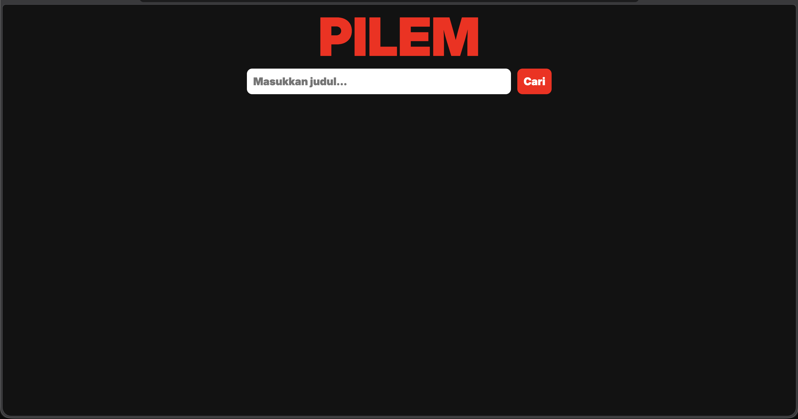
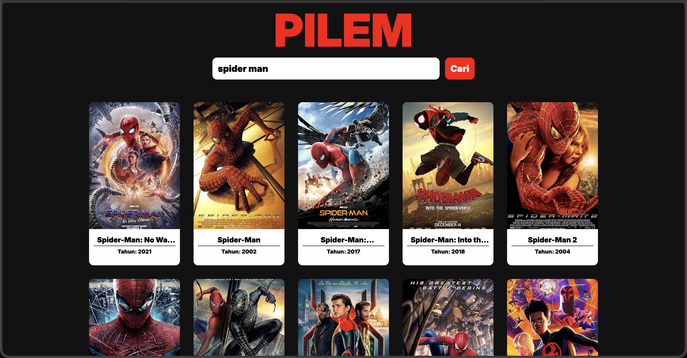
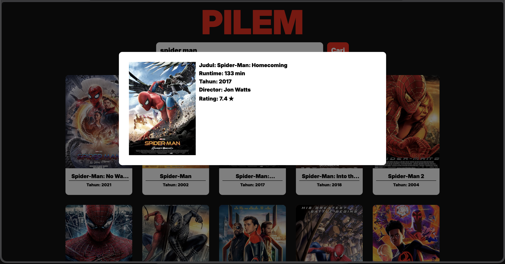

# Pelacakan Pengeluaran
Website tentang pencarian movie sederhana menggunakan React + Vite dan menggunakan api dari [OMDb API](https://www.omdbapi.com/).

# Fitur
1. Melakukan pencarian berdasarkan judul film
2. Menampilkan detail dari film yang diinginkan
3. Memiliki fitur pindah page

# Install

1. Install dependencies: `pnpm install`
2. run: `pnpm run dev`
3. Masuk ke website [OMDb API](https://www.omdbapi.com/) dan buat akun.
4. Simpan api yang didapat.
5. Buat sebuah file .env di root, lalu isi dengan base url dan apikey.
6. Selesai.

# Screenshots

